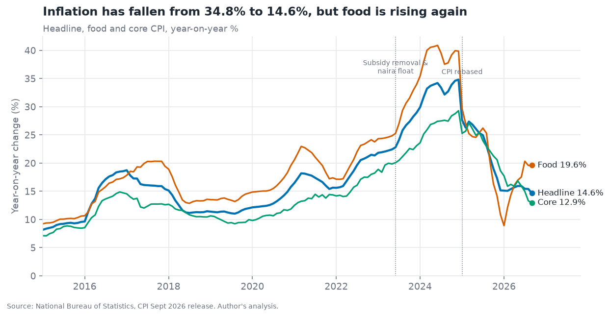
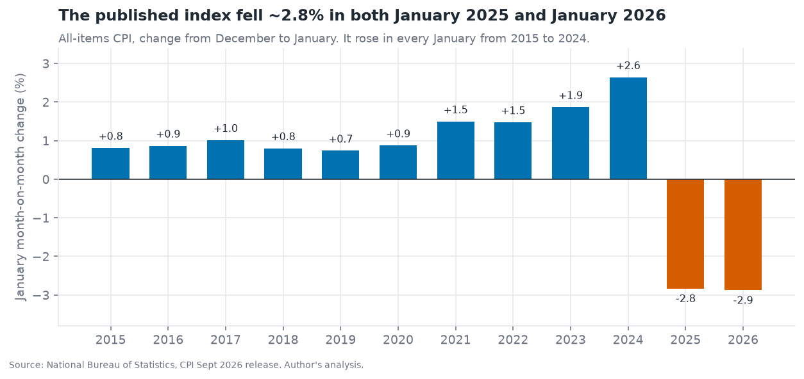
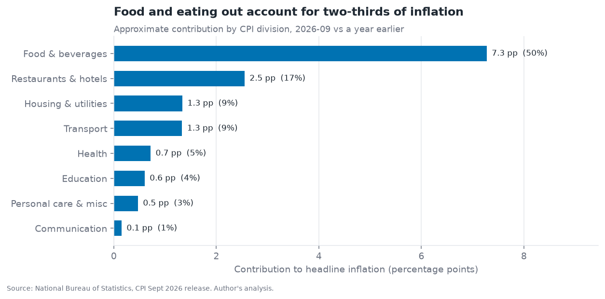
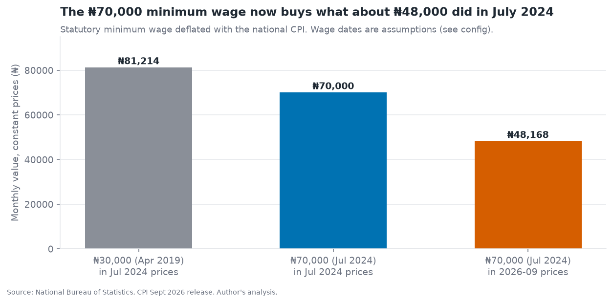
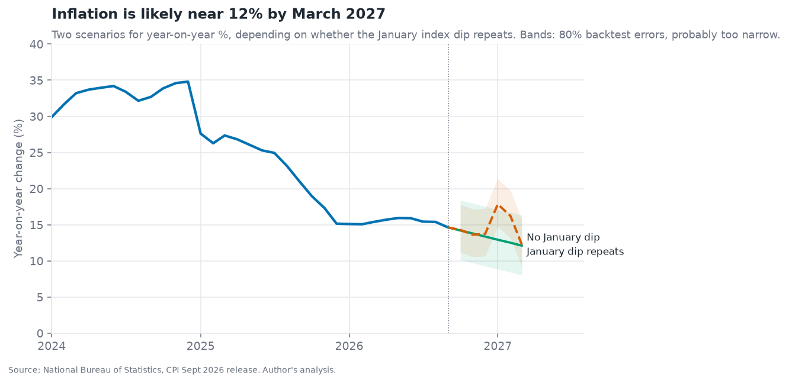
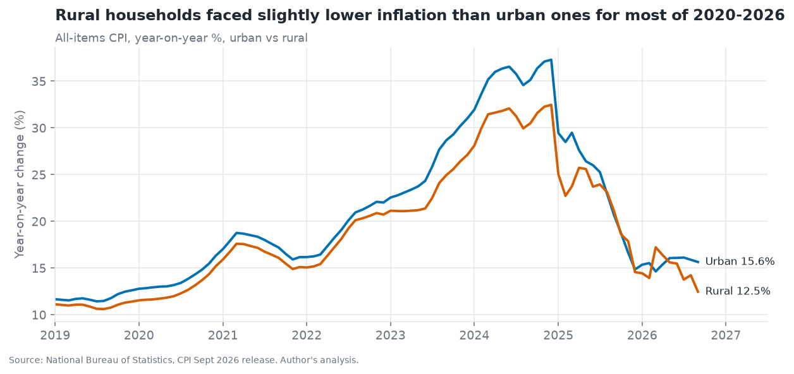

# Nigeria Cost-of-Living Tracker

> What has happened to prices in Nigeria since the fuel-subsidy removal, who is hit hardest, and what is the outlook? Built on **real National Bureau of Statistics CPI data (Jan 1995 to Sep 2026)**, with a data-quality finding that changes how the headline numbers should be read.

**Author:** Emmanuel Omowumi · [LinkedIn](https://www.linkedin.com/in/emmanuel-omowumi-98bb03139/) · emmanueloluwatobi2015@gmail.com
**Audience:** finance, strategy, HR/reward and pricing teams that need a defensible view of Nigerian inflation.



## Key findings

| # | Finding | Evidence |
|---|---|---|
| 1 | **Headline inflation has fallen, but food is rising again.** | Headline 14.6% in Sep 2026 (34.8% in Dec 2024). Food fell to 8.9% in Jan 2026 and is back to 19.6%, above headline and core (12.9%). |
| 2 | **Food and eating out drive about two-thirds of inflation.** | Food & beverages ≈ 50% of the 14.6%, restaurants & hotels ≈ 17% (approximate contributions, 2024 weights). |
| 3 | **A naira has lost about half its purchasing power since May 2023.** | ₦100,000 in May 2023 needs ≈ ₦204,000 today. Sensitivity range: 51% to 55% lost (see finding 5). |
| 4 | **The ₦70,000 minimum wage has been eroded.** | In Jul 2024 prices it is worth ≈ ₦48,000 today; matching its Jul 2024 value needs ≈ ₦102,000 (≈ ₦112,000 under the sensitivity case). The 2019 ₦30,000 wage was worth ≈ ₦81,000 in Jul 2024 prices, more than the 2024 raise. |
| 5 | **The published index falls ~2.8% every January since the 2025 rebasing.** | Dec→Jan m/m: −2.83% (2025) and −2.88% (2026). From 1996 to 2024 no January fell by more than 0.83%. The workbook gives no reason. This matters: see below. |
| 6 | **Rural inflation has been lower than urban for most of 2020-26.** | Rural below urban in 94% of months since 2020 (avg −1.9 pp). Sep 2026: urban 15.6%, rural 12.5%. |
| 7 | **Outlook: ~12% by March 2027 under both scenarios.** | 80% band roughly 8% to 16%. If the January dip does not repeat, y/y mechanically jumps to ~18% in Jan 2027 (a base effect, not new inflation). |



### Why finding 5 matters

NBS's year-on-year figures treat the index as continuous, and I reproduce them exactly (a test checks this against the published values to 0.01 pp). But an all-items index that drops 2.8% in January, after being positive in every year from 2015 to 2024, is a data question an analyst should raise, not hide. Two consequences:

- Cumulative measures that span a January (purchasing power since 2023, the minimum-wage comparison) are shown **as published, with a sensitivity case** that replaces each January's change with the average of the months either side. The truth is probably between the two.
- The six-month outlook is shown as **two scenarios** (dip repeats / does not repeat) rather than one false-precision number.

I cannot tell from the data whether the dips reflect a methodology feature of the 2024-base CPI or a real seasonal price fall. The right next step is to ask NBS, and I list it under next steps.

## Charts

| | |
|---|---|
|  |  |
|  |  |

## Recommendations (by audience)

| Audience | Action | Based on |
|---|---|---|
| Reward / HR | Review pay bands against the **₦102k-₦112k** equivalent of the 2024 minimum wage, not the nominal ₦70k, and plan for a food-led squeeze on lower grades. | 3, 4 |
| Pricing / FMCG | Expect input-cost pressure to stay food-led; stress-test price lists at ~12-16% inflation through March 2027. | 1, 2, 7 |
| Finance / FP&A | Budget with both scenarios and treat January 2027 y/y as a **base-effect** month before reacting to it. | 5, 7 |
| Anyone quoting CPI | State the vintage and flag the January index behaviour whenever a cumulative figure crosses it. | 5 |

## Data

| | |
|---|---|
| Source | [National Bureau of Statistics, Consumer Price Index and Inflation (NGA-NBS-CPI)](https://microdata.nigerianstat.gov.ng/index.php/catalog/154), September 2026 release (`cpi_1New_September2026.xlsx`) |
| Coverage | Monthly, Jan 1995 to Sep 2026; national, urban and rural; 13 COICOP divisions plus food, core, energy, farm produce, goods and services |
| Base | 2024 = 100 (rebased CPI, 934 varieties) |
| Not NBS data | Minimum wage levels and dates (₦30,000 from Apr 2019, ₦70,000 from Jul 2024) are assumptions in `src/config.py`. Check them against the statutes before quoting. |
| Raw file | Kept in `data/raw/` for reproducibility. NBS is the owner; cite it if you reuse this. |

## Method

1. **Extract.** The workbook is laid out for people (year only on the first row of each year, month names, merged headers). `src/extract.py` tidies it into long format and validates it.
2. **Validate.** Recomputed y/y matches NBS's published y/y on all 300+ months (max difference < 0.01 pp).
3. **Analyse.** Y/Y and m/m, division contributions, purchasing-power and wage deflation, urban vs rural, January-dip sensitivity.
4. **Forecast.** Three methods (naive, smoothed average, seasonal-naive-with-drift) backtested on 102 rolling origins from 2016-2024 at 1-6 month horizons. At 6 months the smoothed average (MAE 2.2 pp) edged the naive baseline (2.3 pp) and seasonal-naive (2.6 pp), which is not a meaningful difference. The outlook is therefore a scenario range, not a precise prediction.
5. **Model for BI.** `src/build_powerbi.py` exports a star schema; `powerbi/measures.dax` holds the measures.

## Limitations

- **The backtest uses 2016-2024, before the rebasing.** The January behaviour after 2025 is not in it, so the error bands are probably too narrow.
- **Contributions are approximate.** They use 2024 basket weights on a chained index and are rescaled to equal the headline; use them to rank drivers.
- **CPI is an average basket.** Households with different spending patterns (food share, rent, transport) face different inflation. State-level CPI is not used here.
- **The minimum-wage deflation uses the national all-items index,** not a household-specific basket.
- **I have not confirmed the cause of the January dips,** only that they exist in the published data.

## Power BI

The repo ships a Power BI-ready model rather than a `.pbix`: the star-schema CSVs and DAX measures are in [`powerbi/`](powerbi), with build steps in [`powerbi/README.md`](powerbi/README.md).

## Reproduce

```bash
pip install -r requirements.txt
python src/run_analysis.py     # tables + data/processed/summary.json
python src/make_figures.py     # figures/
python src/build_powerbi.py    # powerbi/*.csv
pytest -q                      # 8 tests, including the NBS cross-check
```

## Project structure

```
src/        config, extract, metrics, forecast, run_analysis, make_figures, build_powerbi
tests/      8 tests: parsing, NBS cross-check, contributions, deflators, forecast
data/raw/   NBS workbook   data/processed/   tidy tables and summary.json
figures/    charts         powerbi/            star-schema CSVs and DAX
docs/       executive brief
```

## Skills demonstrated

| Skill | Evidence |
|---|---|
| Real-data wrangling | Reverse-engineered a human-formatted government workbook into a validated tidy dataset |
| Data-quality judgement | Found and flagged the January index anomaly, shown with a sensitivity case instead of hidden |
| Analytical rigour | Cross-checked against published figures; backtested forecasts and reported that the methods barely differ |
| Business storytelling | One-page [executive brief](docs/executive_brief.md), findings stated with evidence and limits |
| BI modelling | Star schema and DAX measures (YoY, MoM, purchasing power, contribution) |
| Engineering habits | Tests, CI that rebuilds all outputs from raw data |

## Next steps

- Ask NBS to confirm the January treatment in the 2024-base index.
- Add state-level CPI and a household-basket calculator (food share and rent as inputs).
- Publish the Power BI report once built and link a screenshot here.
